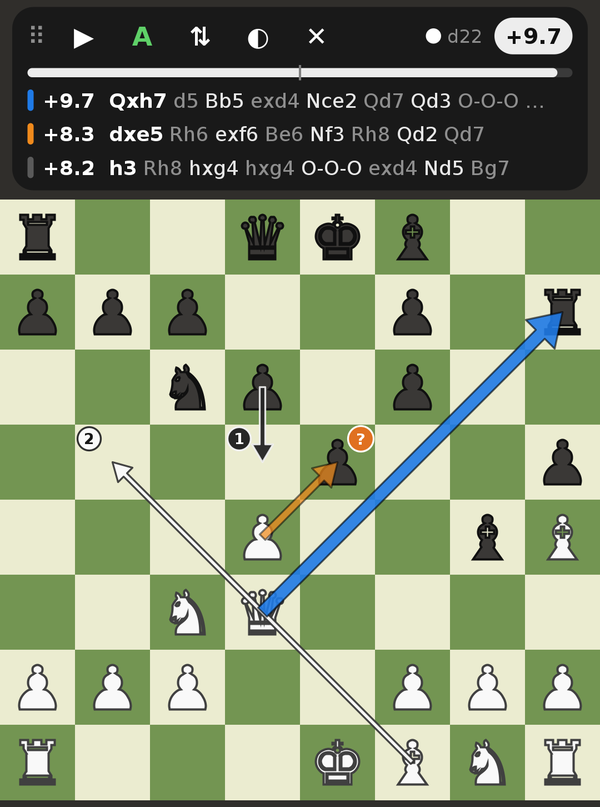
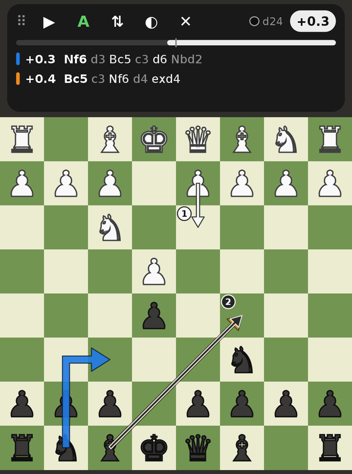
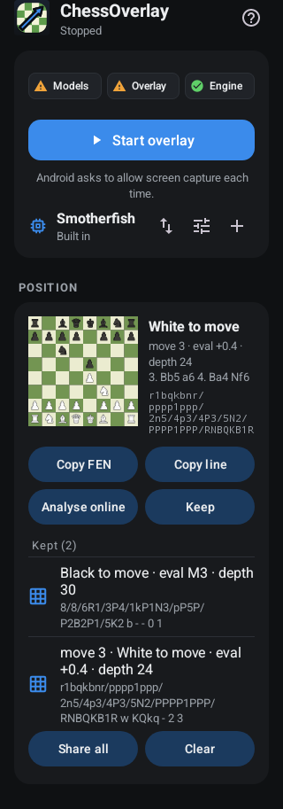
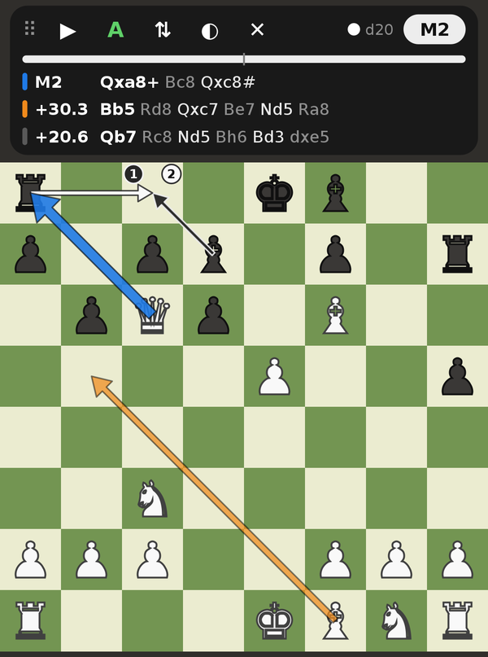

<p align="center">
  
</p>

<h1 align="center">ChessOverlay</h1>

<p align="center">Live chess engine analysis drawn over any chess board on your Android screen.</p>

<p align="center">
  <a href="https://github.com/Demonic1594/ChessOverlay/actions/workflows/build.yml"></a>
  
  
  <a href="LICENSE"></a>
</p>

<p align="center">
  <a href="#features">Features</a> &middot;
  <a href="#getting-started">Getting started</a> &middot;
  <a href="#usage">Usage</a> &middot;
  <a href="docs/how-it-works.md">How it works</a> &middot;
  <a href="#development">Development</a> &middot;
  <a href="#contributing">Contributing</a> &middot;
  <a href="#licence">Licence</a>
</p>

| Middlegame: three lines, the best line's next moves numbered, the last move graded | Black to move: knight moves bend like an L so they cross no other piece |
|---|---|
|  |  |

## Overview

ChessOverlay reads a chess board straight from the screen, analyses the position with a chess engine, and draws the result over the board: arrows for the best moves, the engine's main line, and a floating card with the evaluation and the engine's lines. It works in any app that shows a board: chess sites in a browser, chess apps, videos, streams and e-books.

It is meant for analysing your own games and studies wherever they are (game archives in other apps, videos, puzzles, books, screenshots) and for collecting positions to come back to.

- **It follows the game.** Consecutive positions are linked by the move between them, so the overlay knows the side to move, the move number, castling rights and repetitions. In play, the move is usually found from the squares that changed alone, and analysis starts within milliseconds: fast enough for bullet.
- **It reads with the game in mind.** During a game the next position can only follow from the previous one by a legal move, so a misread square or a piece hidden under the site's arrow cannot turn into another piece, and a board turned round is still the same game.
- **It keeps the board clean.** Only arrows are drawn on the board. The evaluation, the lines and the controls are in a floating card that can be dragged anywhere.

## Responsible use

ChessOverlay is an analysis tool. It has no built-in restriction on where it runs; how it is used is the user's responsibility.

Using engine assistance in a live game against another person is cheating. It breaks the fair-play rules of Chess.com, Lichess and every other chess platform and over-the-board event; they detect it and close accounts for it. The authors do not support that use and are not responsible for any penalty that follows from it.

## Features

### Board recognition

- Finds the board anywhere on screen and reads all 64 squares and which side is at the bottom. The recognition is a Kotlin port of [chessimg2pos](https://github.com/mdicio/chessimg2pos) v2; its models run on ONNX Runtime and are bundled in the APK, the board model quantized to int8, which makes a read about twice as fast and shrinks the models from 125 MB to 38 MB.
- Refines the located board to its exact edges before reading it. On the 200-board benchmark that CI runs, this raised the number of boards read correctly from 179 to 197.
- Measures the phone once, at the overlay's first start, and keeps the fastest way of running the models that reads correctly (ONNX Runtime's CPU code with one, two or four threads; XNNPACK and NNAPI can be tried with **Test recognition**).

### Following a game

- **Auto mode** (on by default) follows the screen without flicker. About 33 times a second it compares 49 sample points per square with the last read, skipping the points under its own drawing. When at least two squares have changed and the board has been still for 80 ms, it is read from a screen capture taken without the overlay's drawing. A capture that no longer matches the still board (a piece started gliding) is discarded, so pieces are never read in flight.
- **Fast enough for bullet.** The squares that changed and the legal moves usually leave exactly one move that explains them, or a move and the reply that came with it. That move is analysed as soon as the board is still, before the recognizer runs; the reading of the capture then confirms or corrects it. In a fast game (the last moves a median 1.5 s apart or less) the board is checked every 20 ms instead of 30, read after 55 ms of stillness instead of 80, and the first lines are shown from depth 4 instead of 8.
- **The game is remembered.** Castling rights, the en passant square and the halfmove clock follow the moves. A step back in the move list, or an undo, restores the position as it was then. The card shows the move number and how often the position came up. The game survives the board leaving the screen for a while.

### Analysis and display

- **Engines.** Smotherfish (Stockfish-based) is built in. Any arm64 UCI engine binary can be added (Stockfish, Komodo, lc0 with a Maia network as its `WeightsFile`, ...), and engine apps that offer engines to chess GUIs (the Open Exchange protocol DroidFish uses) are found automatically. Every UCI option the engine declares can be edited.
- **On the board, only arrows.** The best move is one bold blue arrow, the next best lines thinner ones in their own colours, and the best line's next moves slim arrows numbered per side in a disc on their destination square. The move just played is graded in the opposite corner: best, good, inaccuracy, mistake or blunder, by the win chance it gave away (lichess's thresholds).
- **Floating card.** The buttons, the evaluation from White's point of view with an evaluation bar, the depth, the move number and repetitions, and one row per engine line in short algebraic notation, with a colour chip that matches its arrow.
- **Steady display.** Lines are shown as whole iterations, never mixed depths. A change of the arrows is shown once two iterations in a row agree on it, or after 700 ms. After a move the engine expected, what it had looked at next is shown at once, dimmed, until the new lines arrive. While a move is read, the drawing is held back rather than blanked and restored. Results of an old position never land on a new one.

### Positions and diagnostics

- A long press on the card copies the position's FEN. The app's position card shows the last position with the engine's line; positions can be kept and shared as text, or opened in lichess's analysis.
- The engine runs under a supervisor that restarts it after a crash and steps down its settings if it falls silent.
- Every read and every engine event is written to a debug log with its timing. The app's tools test the engine, measure recognition, copy the log and share the screen of the last misread.

## Getting started

### Requirements

| | |
|---|---|
| Android | 8.0 (API 26) or later |
| CPU | arm64-v8a |
| Permissions | Display over other apps; screen capture (Android asks at every start); notifications on Android 13 and later |

### Download

There are no GitHub Releases yet. APKs are built by GitHub Actions:

1. Open **Actions**, choose the **Build APK** workflow and pick the latest successful run on the branch you want.
2. Under **Artifacts**, download `chessoverlay-apk` and unzip it.
3. Install `app-release.apk`.

APKs from pushes to `main` and from manual runs are signed with the project key, so a newer one installs over an older one. APKs from pull requests are signed with a temporary debug key and do not install over another build: uninstall the previous one first.

### Install

When Android asks, allow your browser or file manager to install apps. It also warns that the app was built for an older Android version: it targets API 28 on purpose (see [Known limitations](#known-limitations)).

### First steps

1. Open the app. The three chips at the top show what the overlay needs: **Models**, **Overlay** (permission to draw over other apps) and **Engine**. Tap an amber chip to set it right.
2. Pick an engine, and adjust its options if you want to.
3. Tap **Start overlay** and allow screen capture.
4. Switch to the app with the board. The overlay finds it, reads it and starts analysing.

## Usage

The app has one screen in four parts; what everything does is also in the Help dialog (the question mark at the top right).

|  |  |
|:---:|:---:|
| The app: status, start button, engine and the last position | The overlay: a mate in two |

- **Status and start.** The chips for what the overlay needs, the start button, and the engine with buttons to change it, open its options and add one. The line under the app's name says whether the overlay is running and how the models are read on this phone.
- **Position.** The last position the overlay saw, with the engine's arrows, who is to move, the evaluation, the depth and the line. **Copy FEN**, **Copy line**, **Analyse online** (lichess.org's analysis) and **Keep**; the kept positions are listed below, to share as text or remove. At most 100 positions are kept.
- **Settings** and **Tools**: below.

### The floating card

| Control | What it does |
|---|---|
| Read now | Reads the screen once and analyses the position. |
| Auto | Switches auto mode, which follows the game by itself, on or off. |
| Side | The side to move: worked out from the game, White, or Black. A choice by hand overrides the game. |
| Arrows | Shows or hides the drawing on the board. |
| Close | Stops the overlay. |

Drag the card by any part of it to move it; it stays where it is put. Tap the evaluation or a line to fold the lines away and back. Keep a finger on the card for a moment to copy the position's FEN to the clipboard.

### Settings

Settings take effect the next time the overlay starts.

| Setting | Values | Default | Effect |
|---|---|---|---|
| Lines | 1 to 5 | 3 | How many moves the engine searches and lists. |
| Time per position | 1, 2, 3, 5, 10 s, unlimited | unlimited | How long the engine analyses a position. Unlimited keeps thinking until the position changes. |
| Start in auto mode | on, off | on | The overlay follows the game from the start. |
| Recognition certainty | 30, 50, 70, 90 % | 50 % | Boards read less surely than this are not analysed. |
| Arrows | 0 to 5 | 2 | How many lines get an arrow on the board. |
| Next moves of the best line | 0 to 6 | 2 | How many of the best line's following moves are drawn as numbered arrows. |
| Scores on the arrows | off, on | off | Writes each line's score at the tip of its arrow. |
| Grade the last move | on, off | on | Marks the move just played on its destination square. |
| Evaluation bar | on, off | on | Shows the evaluation bar on the card. |
| Engine lines | on, off | on | Lists the engine's lines on the card. |
| Put the card back next to the board | button | | Returns the card to where it follows the board. |

The settings are named only; what each does is in the Help dialog. The board in the position card is drawn with the arrow settings (with a sample position until the overlay has seen one), so their effect is seen at once.

### Engines

- **Built in:** Smotherfish.
- **An engine file:** any arm64 UCI engine binary, added with the **+** button next to the engine.
- **Engine apps:** apps that offer engines to chess GUIs over the Open Exchange protocol are found automatically.
- **Options:** every UCI option the engine declares, grouped into Strength, Smotherfish, Performance and Other. This includes `UCI_LimitStrength` and `UCI_Elo`, and Smotherfish's own `Analysis Elo` and `Smother*` options.

### Tools

| Tool | What it does |
|---|---|
| Test the engine | Starts the engine as the overlay does, with your options, analyses a test position and reports what happened. |
| Test recognition | Times a read with each way of running the models on this phone, shows the table and keeps the fastest that reads correctly. |
| Copy the debug log | Copies the log of reads and engine events to the clipboard for a bug report. |
| Share the last misread screen | Shares the screen of the last misread, as the app saw it. A screen is kept only when a board was read wrongly twice in a row. |
| Clear the log | Empties the debug log. |

### Troubleshooting

| Symptom | What to do |
|---|---|
| Nothing is drawn | The app should say **Running**, and the app with the board should be in front. The card says what the overlay is doing; *Looking for a board* means it has not found one yet. |
| *No clear board found* | The board must be large, sharp and square on screen: zoom in, close side panels and let animations finish. |
| The position is wrong | Use **Share the last misread screen** and **Copy the debug log**, and open an issue with both. |
| *Board gone; looking for it* | The board left the screen, or could not be read three times in a row. The analysis resumes when it is back. |
| The card reports the engine stopping or staying silent | Run **Test the engine**. A silent engine is restarted with safer settings by itself; the log says what happened. |
| Reading is slow | Run **Test recognition**; its table says where the time goes on this phone. |

### What a picture cannot tell

Recognition reads the pieces, not the move history. In a game the overlay follows, castling rights, the en passant square and the halfmove clock follow the moves. For a position it jumps to directly (the move list, a game joined late), castling is taken to be possible while king and rook stand on their squares, and whether a pawn has just advanced two squares is unknown. Without auto mode, the side to move is the side at the bottom unless a king is in check; the **Side** control overrides it.

The full guide, with every part of the screen, is in [docs/usage.md](docs/usage.md).

## How it works

```
Screen capture
      |
      v
Locate the board --> refine its edges --> classify the 64 squares and the orientation
      |
      v
Read in the light of the game: which move leads from the last position to this one?
      |
      v
Engine analysis (UCI) --> lines, scores, the grade of the last move
      |
      v
Overlay: arrows on the board, a floating card for everything else
```

The code is split in two modules: `core` (plain Kotlin: chess rules, UCI, engine supervision, game tracking, the reading logic and the overlay's layout) and `app` (Android: screen capture, the recognizer on ONNX Runtime, the views). [docs/how-it-works.md](docs/how-it-works.md) describes each step and the numbers behind it.

## Development

### Project layout

```
core/    Plain Kotlin, no Android: chess rules, UCI parsing, engine supervision,
         game tracking, board reading, the overlay's layout as plain shapes
app/     The Android app: screen capture, the recognizer, views, settings, engines
tools/   bench/gen.py (benchmark boards)     compile.py (compile without the Android SDK)
         icon.py (the app icon)              quantize_models.py (int8 board model)
docs/    The documentation and its images
.github/workflows/build.yml    Build, tests, benchmark, APK
```

### Build from source

JDK 17 or later and the Android SDK (platform 35) are needed.

```sh
./gradlew assembleRelease
```

The APK is written to `app/build/outputs/apk/release/app-release.apk`. Such a build has no engine or recognition models in it unless you add them: see [docs/development.md](docs/development.md).

### Run the tests

| Command | Runs | Needs |
|---|---|---|
| `./gradlew :core:test` | `core`'s tests on the JVM | Nothing; with `ENGINE_BIN=/path/to/engine` also the engine code against a real engine |
| `./gradlew testDebugUnitTest` | The app's tests on the JVM | `MODELS=/folder/with/the/onnx/models` for the recognizer; `QMODELS` and `BENCH` for the rest |
| `./gradlew connectedDebugAndroidTest` | The app's tests on a device or emulator | A device; `-PextraAbi=x86_64` for an x86_64 emulator |
| `python3 tools/compile.py --run` | Compiles everything and runs `core`'s tests where the Android SDK cannot run | JDK 17 or later only |

CI runs the Gradle tasks on every change, plus the benchmark and the engine on real arm64 hardware. Details, the list of artifacts, the benchmark and how another engine is bundled: [docs/development.md](docs/development.md).

## Documentation

| Document | Contents |
|---|---|
| [User guide](docs/usage.md) | Every part of the app: the floating card and what it can say, the settings, engines, positions, the tools, privacy |
| [How it works](docs/how-it-works.md) | From the screen to the arrows: recognition, game tracking, auto mode, analysis, drawing |
| [Development guide](docs/development.md) | Building, signing, the tests and what each needs, CI and its artifacts, the benchmark |
| [Contributing](CONTRIBUTING.md) | How to report a problem, and what a pull request should contain |
| [Third-party notices](THIRD_PARTY_NOTICES.md) | The licences of what the APK contains |

## Known limitations

- **Not on Google Play.** The app targets API 28 on purpose: from API 29 on, Android does not let an app execute files it wrote itself, which loading your own engines depends on (DroidFish does the same). It can be sideloaded only.
- **The locator is the weak link of recognition.** On 2 of the 200 benchmark boards it returns a tilted box for a board that stands square, and nothing corrects that. On 1 board, a position of only kings and pawns turned for Black, the model's orientation is wrong even with exact corners.
- **Not tested on phones in CI.** CI runs the app on an x86_64 emulator (Android 14) and the engine on arm64 hardware. How fast a phone reads, and whether the shorter delays of a fast game suit every chess site's animations, can only be seen on the device.
- **The benchmark's phone screens are simplified.** They show a board with bars above and below it, not the full layout of a chess app.

## Contributing

Issues and pull requests are welcome. [CONTRIBUTING.md](CONTRIBUTING.md) says how to report a problem and what a pull request should contain.

## Licence

Copyright (C) 2026 Demonic1594.

ChessOverlay is free software under the [GNU General Public License, version 3](LICENSE). You may use, study, change and share it. Anyone who shares it, changed or not, must keep the copyright and credit notices, ship it under the same licence, and give everyone who receives it the full source code. It cannot be turned into closed-source software.

Smotherfish, the built-in engine, is also by Demonic1594 and is under GPL-3.0 too, as a derivative of Stockfish (copyright the Stockfish developers). The other parts of the APK keep their own licences: see [Third-party software](#third-party-software).

## Third-party software

| Component | Used for | Licence |
|---|---|---|
| [chessimg2pos](https://github.com/mdicio/chessimg2pos) v2 | Recognition models, and the method ported in `vision/` | MIT |
| [ONNX Runtime](https://github.com/microsoft/onnxruntime) | Running the models | MIT |
| [Smotherfish](https://github.com/Demonic1594/Smotherfish) / [Stockfish](https://stockfishchess.org) | The built-in engine, as a separate executable | GPL-3.0 |
| AndroidX, Material Components, Kotlin, kotlinx.coroutines | The app | Apache-2.0 |

[THIRD_PARTY_NOTICES.md](THIRD_PARTY_NOTICES.md) has the licence texts, and the Smotherfish commit each build is made from. The Open Exchange engine discovery follows the protocol of Kalab's chess engine support library (Apache-2.0); none of its code is in the APK.

<sub>The overlay images are rendered in CI by the overlay's own drawing code on a phone-sized board. The app screenshots were taken on the emulator the tests run on, 320 px wide.</sub>
