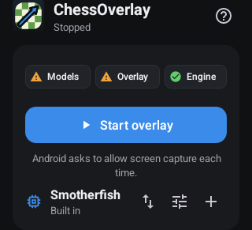
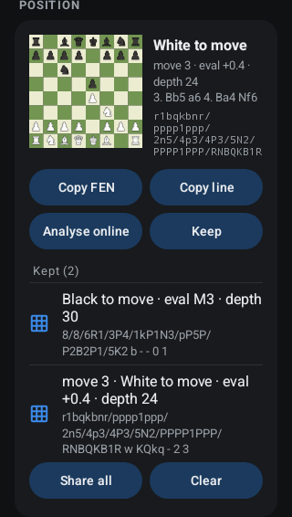
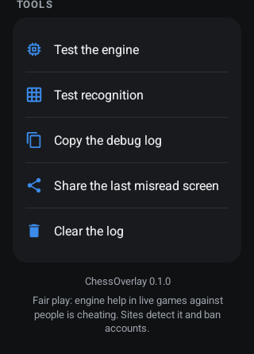
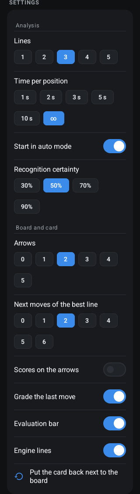

# Using ChessOverlay

This page describes every part of the app and what to do when something goes wrong. How the recognition and the game tracking work is in [how-it-works.md](how-it-works.md).

|    |  |
|:---:|:---:|
| Status, position and tools | Settings |

The app has one screen in four parts: what starts the overlay, the last position, the settings and the tools. It names things and leaves out what they do; that is in the Help dialog, behind the question mark at the top right.

## Starting the overlay

The first card holds what the overlay needs:

- **Models** is board recognition. Builds from CI carry the recognition models; a build made without them downloads them once, about 170 MB, when the chip is tapped.
- **Overlay** is the permission to draw over other apps.
- **Engine** is at least one engine to analyse with.

A chip shows a tick when its part is ready and a warning sign otherwise; tapping an amber chip does what is needed. The line under the app's name says whether the overlay is running and, once it was measured, how the models are read on this phone (for example `reads with cpu:2`).

Below the chips is the engine, on one line: its name and where it came from, a button to change it, one to open its options, and **+** to add an engine file.

Tap **Start overlay** and allow screen capture. Android asks for that permission at every start. The overlay then runs as a foreground service, with a notification, until it is closed from its card or stopped from the app.

Switch to the app with the board. The overlay finds the board, reads it and starts analysing; with auto mode on, it follows the game from there.

## The floating card

The card sits next to the board and can be dragged anywhere; it stays where it is put.

| Control | What it does |
|---|---|
| Read now | Reads the screen once and analyses the position, also when auto mode is off. |
| Auto | Switches auto mode, which follows the game by itself, on or off. It is on at the start when the setting *Start in auto mode* is on. |
| Side | The side to move: worked out from the game, White, Black, in that order. A side chosen by hand overrides what the game says. |
| Arrows | Shows or hides the drawing on the board. |
| Close | Stops the overlay. |

Tap the evaluation or a line to fold the lines away and back. Keep a finger on the card for a moment to copy the position's FEN to the clipboard, for pasting anywhere.

Under the buttons are an evaluation bar and one row per engine line: its colour chip matches its arrow, the first move is in bold, and the moves after it are dimmed. Next to the score the card shows the depth, how often the position came up in the game and the number of the move, as far as the card is wide. A dimmed line and dimmed arrows are what the engine expected of the position, from its line for the one before.

### What the card can say

| Message | Meaning |
|---|---|
| Looking for a board | No board was found on the screen yet. |
| Analysing | The engine is searching; lines follow from depth 8 (depth 4 in a fast game). |
| Checkmate: White wins, or Black wins | The side to move has no legal move and is in check. |
| Stalemate: a draw | The side to move has no legal move. |
| No clear board found | A read by hand found nothing sure enough. |
| Board misread | The board could not be read as a position a game can reach; read again. |
| Board gone; looking for it | The board left the screen, or could not be read three times in a row. The game is kept and the analysis resumes when the board is back. |
| Engine silent; restarting it | The engine said nothing for six seconds. It is restarted, each time with safer settings. |
| The engine crashed twice on this position; skipped | The position is not analysed again in this session. |

In auto mode, a misread changes nothing: the last analysis stays and the board is read again after 0.5 s, then 1, 2, 4 and 8 s.

## Settings

Settings take effect the next time the overlay starts.

| Setting | Values | Default | Effect |
|---|---|---|---|
| Lines | 1 to 5 | 3 | How many moves the engine searches and lists (MultiPV). |
| Time per position | 1, 2, 3, 5, 10 s, unlimited | unlimited | How long the engine analyses a position. Unlimited keeps thinking until the position changes. |
| Start in auto mode | on, off | on | The overlay follows the game from the start. |
| Recognition certainty | 30, 50, 70, 90 % | 50 % | A board is read with the probability of its least certain square. Below this, it is not analysed. |
| Arrows | 0 to 5 | 2 | How many lines get an arrow on the board. |
| Next moves of the best line | 0 to 6 | 2 | How many of the best line's following moves are drawn as numbered arrows. |
| Scores on the arrows | off, on | off | Writes each line's score at the tip of its arrow. |
| Grade the last move | on, off | on | Marks the move just played on its destination square. |
| Evaluation bar | on, off | on | Shows the evaluation bar on the card. |
| Engine lines | on, off | on | Lists the engine's lines on the card. |
| Put the card back next to the board | button | | Returns the card to where it follows the board. |

The board in the position card is drawn with the arrow settings, with a sample position until the overlay has seen one, so their effect is seen at once.

### What is drawn on the board

- The best move is one bold blue arrow; the next best lines get thinner arrows in their own colours. Knight moves bend like an L, so they cross no other piece.
- The best line's following moves are slim arrows in the colour of the side that plays them, numbered per side in a disc on their destination square: White's first, second and third moves in light discs, Black's in dark ones.
- The move just played is graded in the opposite corner of its destination square: best when it was the engine's first line, good when it gave away less than 5 points of win chance, an inaccuracy under 10, a mistake under 15, a blunder beyond.

## Engines

- **Built in.** Smotherfish, a Stockfish-based engine, is part of the APK that CI builds.
- **An engine file.** Any arm64 UCI engine binary can be added with **+** next to the engine: Stockfish, Komodo, lc0 with a Maia network set as its `WeightsFile`. The file is copied into the app.
- **Engine apps.** Apps that offer engines to chess GUIs over the Open Exchange protocol, as DroidFish uses, are found by themselves.
- **Options.** The sliders button opens every UCI option the engine declares, grouped into Strength, Smotherfish, Performance and Other. `UCI_LimitStrength` with `UCI_Elo`, and Smotherfish's `Analysis Elo` and `Smother*` options, are among them. The options are kept per engine.

An engine that supports `MultiPV` is asked for as many lines as the *Lines* setting; otherwise it gives one.

## Positions

- A long press on the floating card copies the position's FEN.
- The app's position card shows the last position the overlay saw (it stays after the overlay stops): who is to move, the move's number, the evaluation and the depth, the engine's line with the game's move numbers, and the FEN. **Copy FEN** and **Copy line** copy them; **Analyse online** opens the position in lichess's analysis; **Keep** adds it to the kept positions.
- A kept position can be copied, analysed online or removed. **Share all** shares the kept positions as text; **Clear** removes them all. At most 100 are kept.

## Tools

| Tool | What it does |
|---|---|
| Test the engine | Starts the engine as the overlay does, with your options and under the same supervision, analyses a test position for a few seconds and says what happened. |
| Test recognition | Times a read of a test board with each way of running the models on this phone, shows the table and keeps the fastest that reads the board as the default does. |
| Copy the debug log | Copies the log to the clipboard. It holds the last 600 lines: every read with its timing and what it found, and every engine event. Every 25 positions and when the overlay closes, a `session:` line sums up the session: moves seen at once from the changed squares and how many the recognizer confirmed or corrected, the reads' median and 90th-percentile times, the side to move taken from the highlight, misreads. |
| Share the last misread screen | Shares the screen of the last misread, as the app saw it. A screen is kept only when a board was read wrongly twice in a row. |
| Clear the log | Empties the debug log. |

### Reporting a problem

For a position that was read wrong, send **Share the last misread screen** and **Copy the debug log** together with what the board showed. The log says, for each read, how long finding, preparing and running the model took, what was read and how sure it was.

## Privacy

Screen captures are processed on the device and are not uploaded. One capture is kept, locally, when a board was read wrongly, and it leaves the phone only if you share it yourself. The app uses the network for two things only: downloading the recognition models (in builds that do not carry them), and opening a position on lichess.org in your browser when you ask for it.

## What a picture cannot tell

Recognition reads the pieces, not the move history.

- In a game the overlay follows move by move, castling rights, the en passant square and the halfmove clock follow the moves: a king or rook that has moved cannot castle any more, and after a pawn's double step the engine is told where a capture en passant could land.
- For a position the overlay jumps to (the move list, a game joined late), castling is taken to be possible while king and rook stand on their squares, and whether a pawn has just advanced two squares is unknown.
- Without auto mode, the side to move is the side at the bottom unless a king is in check. The **Side** control overrides it.
- A step back in the move list, or an undo, takes the position as the game had it, as far back as the game was followed.
- The site's last-move highlight fills these gaps where it is clear: exactly two tinted squares, one empty and one holding a piece that could have come from it, say that piece's colour moved last. That gives the side to move after a jump, on a first read or without auto mode, and the en passant square after a pawn's double step. The tint's colour does not matter; no highlight, or more marks than a last move (a premove, your own arrows), means nothing is assumed.
